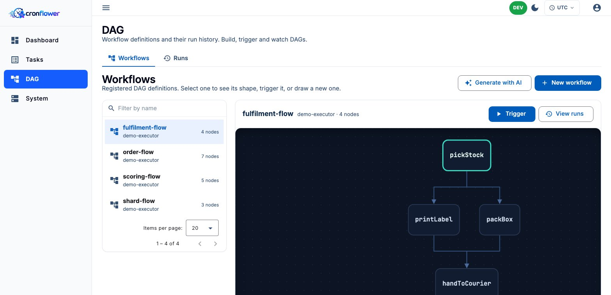
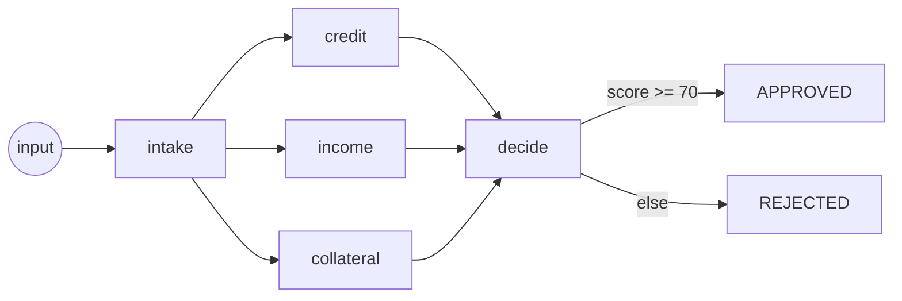
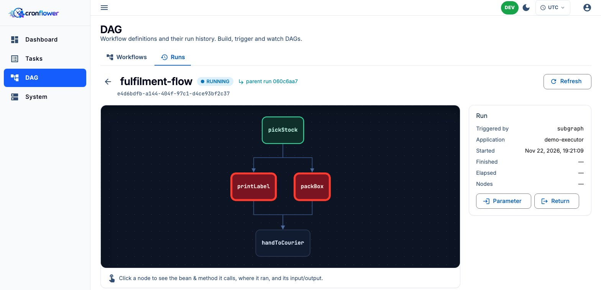
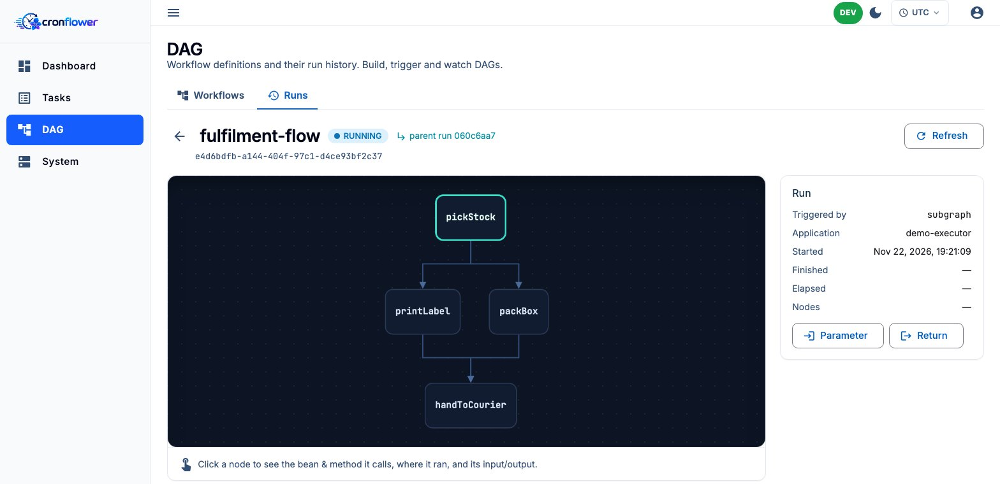
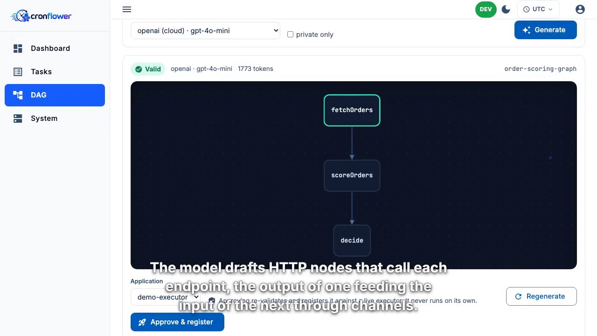

# cronflower: run a DAG workflow across your cluster, instead of chaining cron jobs

**cronflower** is an open-source, distributed scheduler for the JVM with a web console. `cronflow` is
its optional DAG add-on: declare the steps and how they depend on each other as a graph, and the same
cluster runs the graph node by node, with data flowing between nodes over typed channels.



<video src="https://raw.githubusercontent.com/paganini2008/cronflower/main/docs/video/dag-workflows.mp4" poster="https://raw.githubusercontent.com/paganini2008/cronflower/main/docs/video/dag-workflows.poster.jpg" controls width="100%"></video>

*▶ Two-minute screencast.*

## What problem does it solve?

Teams end up chaining cron jobs: one at 02:00 charges the orders, another at 02:15 ships them, set
fifteen minutes later because that is *usually* long enough for the first to finish. There is no real
dependency, no shared data, and no way to tell afterwards whether step two ran because step one
succeeded or just because the clock moved.

That is the wall plain cron hits: it schedules single jobs, it cannot orchestrate a flow of them. A
DAG makes the dependency real, lets data flow between steps, and records every run.

## Quick start

```bash
git clone https://github.com/paganini2008/cronflower
cd cronflower/deploy
./run-local.sh -e 1          # scheduler + console + 1 executor
```

Open <http://localhost:7200> (`admin` / `admin123`) and the example DAGs are registered under **DAG >
Workflows**, ready to trigger.

Prefer prebuilt images? Pull them from Docker Hub or GHCR, no checkout needed:

```bash
curl -O https://raw.githubusercontent.com/paganini2008/cronflower/main/backend/cronflower-docker/docker-compose.yaml
docker compose up -d          # 3 schedulers + console on http://localhost:7200
```

## Requirements

| Need | Version / note |
|------|----------------|
| JDK | 17+ (builds via the bundled Maven Wrapper) |
| Node | 20+ (builds the console) |
| cronflow add-on | `cronflow-spring-boot-starter` on the scheduler, `cronflow-executor-spring-boot-starter` on the executor |
| Database | optional: none → embedded H2, MySQL / PostgreSQL for a shared store |

## How it works

A DAG is a Spring bean: `@Dag` names it, each `@DagNode` method is a step, and the `to` list is the
edges. A node returns a `Map` of named **channel** writes, downstream nodes read them from a
`DagState`. Each `@Channel` says how concurrent writes to it merge, via a **reducer**. The engine
drives the graph **across the whole cluster**, dispatching each node to a live executor.



## Code examples

### Declare a workflow: `@Dag`

**Input**: a bean with `@Dag` + `@DagNode` methods and typed channels:

```java
@Dag(name = "scoring-flow", inputs = {"input"}, channels = {
        @Channel(name = "score",   reducer = ChannelReducer.SUM_INT),
        @Channel(name = "factors", reducer = ChannelReducer.JOIN_CSV)})
@Component
public class ScoringFlow {

    @DagNode(entry = true, to = {"credit", "income", "collateral"})     // fan out to 3 parallel scorers
    public Map<String, Object> intake(DagState state) {
        return Map.of("applicant", state.getString("input"));
    }

    @DagNode(to = {"decide"})
    public Map<String, Object> credit(DagState state) {
        return Map.of("score", 40, "factors", "credit");
    }
    // income(), collateral() … same shape, writing to the same channels

    @DagNode(trigger = "ALL")                                           // join: wait for all three
    public Map<String, Object> decide(DagState state) {
        long total = state.getLong("score");                           // reducer already summed them
        return Map.of("decision", total >= 70 ? "APPROVED" : "REJECTED");
    }
}
```

**Execution**: three scorers run in parallel, each writing `score`, the reducer merges the concurrent
writes (summed to 90) so `decide` reads one combined value. No shared mutable state, no ordering
assumptions.

**Output**: the console renders the graph, a run lights up node by node, each node showing **which
executor ran it**, so a wide fan-out really runs in parallel on different machines:



### Edges beyond straight lines

```java
@DagNode(when = @When(expr = "#risk > 80", to = "humanReview"), otherwise = {"fulfilment"})
public Map<String, Object> riskScore(DagState state) { /* writes risk */ }

@DagNode(subgraph = "fulfilment-flow", to = {"notify"})                // nest a whole other DAG
public Map<String, Object> fulfilment(DagState state) { /* ... */ }

@DagNode(shard = @Shard(input = "ids", output = "squares"), to = {"report"})
public Map<String, Object> square(DagState state) { /* runs once per id, at run time */ }
```

- **`when` + `otherwise`**: route by a SpEL expression over the channels.
- **`trigger`**: `ALL` waits for every upstream edge, `ANY` fires on the first arrival.
- **`subgraph`**: a node is a whole other DAG, so you compose instead of copy.
- **`@Shard`**: fan out dynamically, once per element of a list known only at run time.

### Three ways to start it

- **By hand** from the console's *Trigger* button, with an optional JSON seed for the input channels.
- **From a finished `@Task`** in the same bean: its return value becomes the DAG input.
- **On a schedule** directly: pick *Trigger DAG* in the *Create Task* form.



## Nodes beyond Java: HTTP and cross application

A node does not have to be a Java bean. A node has a `kind`, and cronflower ships three:

| Kind | What it runs | Where it runs |
|------|--------------|---------------|
| `bean` | a `@DagNode` method on an executor | the executor that hosts the bean |
| `script` | a shell, Python, Java or SQL script | an executor, in a per run Docker sandbox |
| `http` | any REST endpoint | the scheduler itself, no executor needed |

An `http` node calls a URL, sends the merged channel state as the request body, and maps the response
back into channels. So the output of one endpoint becomes the input of the next, the same way a Spring
service method feeds the next. The service behind each node can be written in Python, Go, Rust or
anything that speaks HTTP, and each node names its own `application`, so one workflow can span several
services. cronflower orchestrates, your services do the work.

```json
{
  "name": "score-orders",
  "kind": "http",
  "endpoint": { "url": "http://risk-svc/score-orders", "method": "POST" },
  "io": { "input": { "orders": "orders" }, "output": { "maxRisk": "score.max" } }
}
```

## Let AI draft the workflow

Open *Generate with AI*, describe the flow in plain language, and an LLM returns a ready `@Dag` for you
to review before you run it. It works against OpenAI or a local Ollama model, and you pick the exact
model from a dropdown. Describe three endpoints and it drafts three `http` nodes wired output to input,
exactly the shape above.

> "Fetch orders from /fetch-orders, score them at /score-orders, then decide at /decide."



## Configuration: channels & reducers

Each `@Channel` merges concurrent writes with a built-in reducer, or your own via `customReducer`:

| Reducer | Merge |
|---------|-------|
| `SUM_INT` / `SUM_LONG` | add the numbers |
| `MAX` / `MIN` | keep the largest / smallest |
| `AND` / `OR` | boolean fold |
| `CONCAT_LIST` / `UNION_SET` | append / union collections |
| `CONCAT_STRING` / `JOIN_CSV` | join text |
| `MERGE_MAP` | merge maps |
| `LAST_WINS` / `FIRST_WINS` / `WRITE_ONCE` | pick one writer |

The executor points at the scheduler with `cronflow.client.server-urls`, the server prefix is
`cronflow.server.api-prefix` (default `/cronflow/dag`).

## Limitations & trade-offs

- The DAG engine rides on the **cronflow add-on** over the scheduler cluster, it is not a standalone
  workflow server. You run cronflower, then add `@Dag` beans.
- Nodes are dispatched to executors over HTTP, so a node's bean must be **reachable and idempotent**
  enough to be retried.
- Channel values cross the wire between nodes, so keep them **serializable and reasonably small**.
- It orchestrates *your* steps, it is not a data-pipeline engine for streaming large datasets.

## Summary

- A DAG is a Spring bean: **`@Dag` + `@DagNode`**, edges via `to`, data via typed **channels**.
- **Reducers** merge concurrent writes, so joins need no locks or ordering assumptions.
- **Branching** (`when`), **join modes** (`ALL`/`ANY`), **subgraphs**, and **dynamic fan-out** (`@Shard`) are annotation attributes.
- The engine **drives the graph across the cluster**, dispatching each node to a live executor.
- Trigger a flow **by hand, from a finished task, or on a schedule**.
- Every run is **recorded** node by node, showing what ran where and what it produced.

Run it: [cronflower on GitHub](https://github.com/paganini2008/cronflower).
